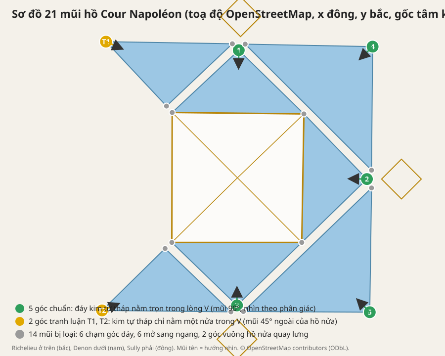

# Đáp án đầy đủ và thể lệ trao thưởng · Louvre V+A Photo Game

Tài liệu cho giảng viên. Mọi toạ độ lấy từ `assets/data/scene.config.json` (OpenStreetMap, x đông, y bắc, mét, gốc tâm kim tự tháp). Bảng dưới do test tự động `tests/answers.test.ts` sinh ra: đổi toạ độ hồ mà đáp án đổi thì test báo đỏ.

## 1. Luật tính

- **V** là hai bờ hồ chụm lại ở một mũi hồ. **A** là kim tự tháp lớn (hai sống nghiêng).
- Một mũi **đạt chuẩn** khi đứng tại mũi, nhìn theo đường phân giác của góc hồ, **cả đáy kim tự tháp nằm trọn trong lòng V** (4 góc đáy đều ở trong góc mở của V, dung sai 1,5°).
- Mũi **tranh luận** khi chỉ một nửa kim tự tháp nằm trong V (một góc đáy nằm đúng trên cạnh V).
- Mũi **bị loại** khi chạm góc đáy kim tự tháp (kim tự tháp thành một cạnh của V), khi V mở sang ngang, hoặc khi kim tự tháp ở sau lưng.
- Kết quả: **21 mũi = 5 chuẩn + 2 tranh luận + 14 loại.** Câu hỏi cuối bài trong game: "có bao nhiêu góc hội tụ đủ V và A?" → **5**.

## 2. Năm góc chuẩn (đáp án chính)

| # | Vị trí (x, y) | Mũi hồ | Góc | Nhìn về (la bàn) | Tiêu cự gợi ý | Ảnh tham chiếu trong game |
|---|---|---|---|---|---|---|
| 2 | (36.4, -0.3) | Hồ trong đông, mũi 90° | 90° | 271° (tây) | 16-20 mm, máy 0,5-1 m | `production/qa/answers/goc-2.png` |
| 4 | (38.0, 36.9) | Hồ góc đông bắc, mũi 91° | 91° | 226° (tây nam) | 24-35 mm | `production/qa/answers/goc-4.png` |
| 1 | (0.4, 35.9) | Hồ trong bắc, mũi 93° | 93° | 181° (nam) | 16-20 mm, máy 0,5-1 m | `production/qa/answers/goc-1.png` |
| 5 | (37.2, -37.7) | Hồ góc đông nam, mũi 90° | 90° | 316° (tây bắc) | 24-35 mm | `production/qa/answers/goc-5.png` |
| 3 | (-0.1, -35.8) | Hồ trong nam, mũi 92° | 92° | 360° (bắc) | 16-20 mm, máy 0,5-1 m | `production/qa/answers/goc-3.png` |

Góc 1, 2, 3 đứng ở đỉnh hồ trong, kim tự tháp nhỏ ngay sau lưng nên chỉ lùi được 2-3 m: cần 16 mm để lấy trọn đáy. Góc 4, 5 là góc vuông của hồ góc: từ trên cao chỉ thấy một góc vuông, phải đứng sát mép nhìn chéo vào kim tự tháp mới thành V, nên học viên thường bỏ sót. Đây là điểm dạy khi chữa bài.

## 3. Hai góc tranh luận

| Mã | Vị trí (x, y) | Mũi hồ | Góc | Nhìn về | Vì sao tranh luận | Ảnh |
|---|---|---|---|---|---|---|
| T1 | (-36.9, 38.3) | Hồ nửa tây bắc, mũi ngoài | 46° | 114° | Kim tự tháp chỉ nằm một nửa trong V (3/4 góc đáy) | `production/qa/answers/goc-T1.png` |
| T2 | (-38.0, -37.2) | Hồ nửa tây nam, mũi ngoài | 45° | 68° | Kim tự tháp chỉ nằm một nửa trong V (3/4 góc đáy) | `production/qa/answers/goc-T2.png` |

Thêm **V phối cảnh**: hai dãy nhà Richelieu và Denon hội tụ về Arc du Carrousel khi nhìn về tây. Có V nhưng không phải V của hồ; chấp nhận nếu nhóm lập luận tốt, không tính là góc chuẩn.

## 4. Mười bốn mũi bị loại

| Vị trí (x, y) | Mũi hồ | Góc | Lý do |
|---|---|---|---|
| (18.7, 18.0) | Hồ trong đông | 45° | Mũi hồ chạm góc đáy kim tự tháp, kim tự tháp thành một cạnh của V |
| (18.1, -18.1) | Hồ trong đông | 45° | Mũi hồ chạm góc đáy kim tự tháp, kim tự tháp thành một cạnh của V |
| (37.7, 2.2) | Hồ góc đông bắc | 46° | V mở sang ngang hoặc ra ngoài, không chứa kim tự tháp |
| (2.2, 37.6) | Hồ góc đông bắc | 44° | V mở sang ngang hoặc ra ngoài, không chứa kim tự tháp |
| (-1.4, 37.7) | Hồ nửa tây bắc | 44° | V mở sang ngang hoặc ra ngoài, không chứa kim tự tháp |
| (-19.9, 20.2) | Hồ nửa tây bắc | 90° | Kim tự tháp ở sau lưng hoặc ngoài lòng V |
| (-18.3, 18.4) | Hồ trong bắc | 44° | Mũi hồ chạm góc đáy kim tự tháp, kim tự tháp thành một cạnh của V |
| (18.7, 18.0) | Hồ trong bắc | 44° | Mũi hồ chạm góc đáy kim tự tháp, kim tự tháp thành một cạnh của V |
| (1.7, -37.5) | Hồ góc đông nam | 44° | V mở sang ngang hoặc ra ngoài, không chứa kim tự tháp |
| (37.7, -2.8) | Hồ góc đông nam | 45° | V mở sang ngang hoặc ra ngoài, không chứa kim tự tháp |
| (-1.8, -37.6) | Hồ nửa tây nam | 43° | V mở sang ngang hoặc ra ngoài, không chứa kim tự tháp |
| (-20.3, -19.8) | Hồ nửa tây nam | 92° | Kim tự tháp ở sau lưng hoặc ngoài lòng V |
| (18.1, -18.1) | Hồ trong nam | 44° | Mũi hồ chạm góc đáy kim tự tháp, kim tự tháp thành một cạnh của V |
| (-18.4, -18.1) | Hồ trong nam | 44° | Mũi hồ chạm góc đáy kim tự tháp, kim tự tháp thành một cạnh của V |

## 5. Easter egg (điểm cộng)

| Mã | Chủ thể | Vị trí (x, y) | Gợi ý tìm | Điểm |
|---|---|---|---|---|
| X | Giàn giáo trùng tu với thanh chéo Saint-André | (-120, 70), đầu tây cánh Richelieu | Nhìn lên tầng 2 cánh bắc gần lối ra Carrousel | +40 lần đầu |
| C | Cổng Métro Art Nouveau kiểu Guimard, tay sắt uốn cong, đèn đỏ | (-126, -52), tây nam quảng trường | Biển MÉTROPOLITAIN xanh | +40 lần đầu |

Trong khung ngắm, huy hiệu vàng X / C sáng khi chủ thể nằm trong khung và cách dưới 20 m. Ảnh ví dụ ngoài đời (thang chéo chữ X, cánh diều chữ C) có ở màn hình vào để học viên hiểu "đường trong bố cục".

## 6. Cách tính điểm trong game

| Hành động | Điểm |
|---|---|
| Chụp một ảnh | +10 |
| Ảnh có chữ A (đỉnh và đáy kim tự tháp trong khung) | +20 |
| Ảnh có chữ V (đứng sát mũi hồ, nhìn theo phân giác) | +20 |
| Máy cân bằng (nghiêng dưới 1°) | +5 |
| Đỉnh kim tự tháp ở 1/3 trên khung | +5 |
| V + A tại góc chuẩn | +30 |
| Lần đầu khám phá một góc chuẩn (tối đa 5) | +50 mỗi góc |
| V + A tại góc tranh luận T1 / T2 | +15 |
| Easter egg X hoặc C lần đầu | +40 mỗi cái |
| Vẽ A, V, chấm đỏ và ghi 1 câu cho một ảnh | +15 mỗi ảnh |
| Trả lời đúng câu hỏi cuối (5 góc) | +100 |

Sao mỗi ảnh: 3 sao từ 80 điểm, 2 sao từ 45, còn lại 1 sao. Ảnh chụp sau khi dùng Gợi ý vẫn được điểm nhưng dashboard ghi "đã dùng gợi ý".

## 7. Thể lệ trao thưởng (đề xuất)

**Điều kiện dự giải**: nhóm nộp trang tổng hợp (hoặc ảnh có trên dashboard) với ít nhất **2 ảnh V + A ở 2 góc khác nhau**, mỗi ảnh có đủ nét A, nét V, chấm đỏ và 1 câu giải thích đỉnh V dẫn mắt vào đâu. Thiếu một điều kiện thì chỉ xét giải phụ.

| Giải | Tiêu chí | Cách chấm |
|---|---|---|
| **Nhất · Mắt kiến trúc** | Tổng điểm trong game cao nhất | Cột "Điểm" trên dashboard, kiểm tra ảnh thật |
| **Nhì · Thợ săn góc** | Khám phá nhiều góc chuẩn nhất (tối đa 5) trong 15 phút, không dùng gợi ý | Cột "Góc" và "Gợi ý" |
| **Ba · Người kể chuyện** | Câu giải thích đỉnh V hay nhất: nói rõ V dẫn mắt vào đâu và vì sao chọn tiêu cự / độ cao máy đó | Giảng viên chấm theo trang tổng hợp, 1 phút trình bày mỗi nhóm |
| **Phụ · Tinh mắt** | Chụp được cả X và C | Cột "Egg" |
| **Phụ · Góc tranh luận** | Lập luận thuyết phục nhất cho T1, T2 hoặc V phối cảnh | Giảng viên chấm khi chữa bài |
| **Phụ · Drone** | Ảnh bay đẹp nhất có V + A (nhãn drone, độ cao ghi trên ảnh) | Bình chọn cả lớp |

**Hoà điểm**: ưu tiên nhóm không dùng gợi ý, rồi nhóm có nhiều ảnh 3 sao hơn, rồi nhóm nộp sớm hơn (thời gian `finished_at` trên dashboard).

**Không hợp lệ**: ảnh chụp từ cửa sổ hoặc bay nhưng không gắn nhãn (game tự gắn, không sửa được), ảnh nhóm khác (mỗi thiết bị một kho ảnh và `device_id` riêng), vẽ sai quy ước (A phải nét liền, V nét đứt).

**Trình tự chữa bài (10 phút)**: mở dashboard, chiếu bản đồ vị trí cuối của các nhóm, bật chế độ giảng viên trong game (`?mode=teacher&pin=1789`) với overlay 5 đáp án xanh và 3 trường hợp vàng, bấm "đến vị trí" lần lượt 1 → 5, đối chiếu ảnh nhóm, công bố câu trả lời 5, trao giải.

## 8. Chấm điểm tự động trên dashboard

Nút **Chấm toàn bộ lớp** trong `/admin.html` tải mọi ảnh của lớp (action `all_photos`) và chạy `src/gameplay/grading.ts`. Thiết kế này rút ra từ buổi chạy thật đầu tiên (35 thiết bị, hơn 600 ảnh), xem mục 8.4.

### 8.1 Nhận diện ảnh và nét vẽ

1. Từ tư thế máy lưu trong metadata ảnh (vị trí, hướng la bàn, độ cao máy, góc ngẩng, tiêu cự, tỷ lệ), chiếu lại sống kim tự tháp (đỉnh tới 4 góc đáy) và hai bờ hồ của mũi hồ nhóm đang đứng vào toạ độ ảnh, cùng mô hình camera với game. Nét xanh lá hiện đè lên ảnh để giảng viên đối chiếu bằng mắt. Trên 31 ảnh thật có nét vẽ, nét A đúng lệch 0 đến 3° so với nét chiếu lại, chứng tỏ phép chiếu khớp với game.
2. So từng nét của nhóm với nét chuẩn, ghép từng nét vào một sống hoặc một bờ hồ (nét thừa bị bỏ qua):
   - **A**: hai nét liền, mỗi nét một sống kim tự tháp. Mỗi nét sai góc dưới 7° và lệch dưới 3,5 % chiều cao khung là **đúng**, dưới 14° và 7 % là **gần đúng**. Chỉ một nét khớp thì cả A là **gần đúng** tối đa.
   - **V**: hai nét đứt, mỗi nét một bờ hồ của mũi hồ đang đứng, cùng ngưỡng như A. Ảnh chụp xa mũi hồ không có bờ để so.
   - **Chấm đỏ** nằm trong lòng V và cách trục phân giác dưới 8 % thì đúng.
   - **Câu ghi chú** từ 12 ký tự và có từ chỉ hướng nhìn (dẫn, mắt, vào, tới...).
3. Một ảnh **vẽ đúng** khi A và V đạt. Một ảnh **vẽ đủ** khi vẽ đúng và có chấm đỏ và có câu ghi chú. Ô chọn "Bắt buộc chấm đỏ và câu ghi chú" quyết định dùng mức nào để xét điều kiện dự giải (mặc định bỏ chọn, xem 8.4).

### 8.2 Gộp máy và điểm chấm lại

- Các máy cùng tên nhóm được gộp (không phân biệt hoa thường, dấu, "Nhóm 10" = "nhóm 10" = "10"). Máy để tên mặc định "Nhóm" không biết thuộc nhóm nào: giảng viên gõ tên nhóm vào ô ngay trong bảng để gộp (lưu trên trình duyệt giảng viên).
- Bộ lọc thời gian (mặc định 8 giờ gần nhất) loại ảnh của buổi thử hôm trước.
- **Điểm chấm lại**, chỉ tính góc khác nhau, chụp lặp một góc không cộng thêm:

| Hạng mục | Điểm |
|---|---|
| Mỗi góc chuẩn có ảnh V+A (tối đa 5) | 100 |
| Mỗi góc tranh luận có ảnh V+A (tối đa 2) | 30 |
| Nét vẽ trên ảnh tốt nhất của mỗi góc: A, V đúng 15 mỗi nét, gần đúng 8 | tối đa 30 mỗi góc |
| Chấm đỏ (5, gần đúng 3) và câu ghi chú (10, gần đúng 5) của ảnh tốt nhất mỗi góc | tối đa 15 mỗi góc |
| Easter egg X, C (gộp các máy của nhóm) | 40 mỗi cái |
| Trả lời đúng câu cuối | 100 |

Điểm game trong máy vẫn hiển thị để tham khảo nhưng không dùng xếp hạng.

### 8.3 Điều kiện dự giải, xếp hạng, giải

- Đủ điều kiện: có ảnh V+A ở ít nhất 2 góc chuẩn khác nhau, mỗi góc có ảnh vẽ đúng (hoặc vẽ đủ khi chọn chế độ chặt).
- Xếp hạng: nhóm đủ điều kiện trước, rồi theo điểm chấm lại, hoà điểm theo mục 7. Đề xuất giải Nhất, Nhì, Tinh mắt tự động; Người kể chuyện liệt kê 3 câu ghi chú dài nhất; Góc tranh luận và Drone liệt kê ứng viên. Nút **Tải CSV** xuất bảng.
- Cảnh báo tự động: nhiều ảnh nhưng ít V+A (chụp hàng loạt), điểm game cao gấp hơn 3 lần điểm chấm lại, nhiều ảnh V+A cùng 1 hoặc 2 góc.
- Việc dùng Gợi ý chỉ biết với máy đã nộp câu hỏi cuối; các máy khác hiện "chưa rõ" và được coi là không dùng.

### 8.4 Bài học từ buổi chạy thật

- Điểm game bị thổi phồng: một máy chụp rồi xoá 275 ảnh được 10 010 điểm với 0 ảnh V+A; một nhóm chụp lặp 26 ảnh ở 3 góc được 2 560 điểm. Vì vậy xếp hạng theo điểm chấm lại.
- Mỗi nhóm có nhiều máy, tên gõ khác nhau ("Nhóm 10", "nhóm 10"), nhiều máy để tên mặc định. Vì vậy gộp theo tên và cho gán tay.
- Chỉ khoảng 30 trong hơn 600 ảnh có nét vẽ, 6 ảnh có câu ghi chú, 5 ảnh có chấm đỏ. Đòi chấm đỏ và câu ghi chú thì không nhóm nào đủ điều kiện, nên chế độ mặc định chỉ đòi A và V đúng; chấm đỏ và câu ghi chú vẫn được điểm và dùng xét giải Người kể chuyện.

Test: `tests/grading.test.ts`. Ảnh minh hoạ: `production/qa/evidence/admin-cham-diem.png`, `production/qa/evidence/admin-cham-lai.png`.

## 9. Ảnh tham chiếu

Chụp từ chính game ở tư thế máy đáp án (bản build hiện tại, Chromium headless, mức medium). Dùng để minh hoạ điều kiện chiến thắng; ảnh học viên chụp sẽ cùng bố cục.

- `production/qa/answers/goc-1.png`: góc 1
- `production/qa/answers/goc-2.png`: góc 2
- `production/qa/answers/goc-3.png`: góc 3
- `production/qa/answers/goc-4.png`: góc 4
- `production/qa/answers/goc-5.png`: góc 5
- `production/qa/answers/goc-T1.png`: góc T1
- `production/qa/answers/goc-T2.png`: góc T2
- `production/qa/answers/tong-quan.png`: toàn cảnh từ 55 m
- `production/qa/answers/so-do-21-mui-ho.svg`: sơ đồ phân loại 21 mũi hồ
